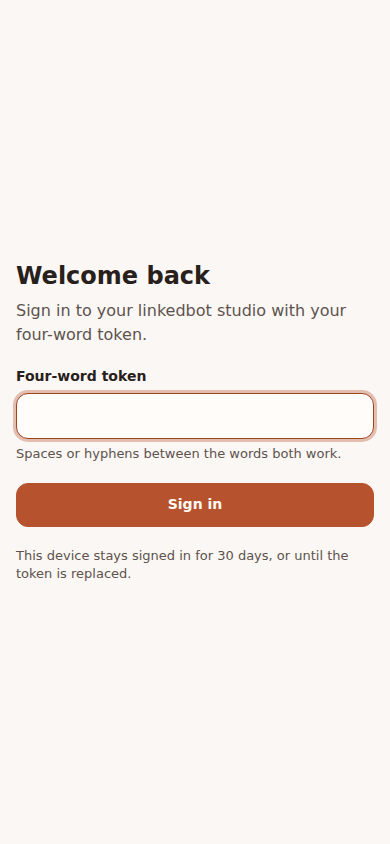
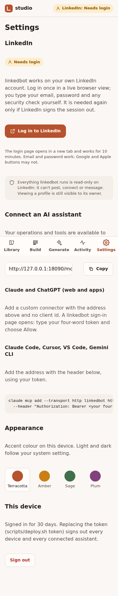

# Journey 1: Sign in and log in to LinkedIn

**Status:** built

## Who and when

The owner, opening the studio for the first time on a new device, or coming back after the LinkedIn
session expired (a job failed with "Session needs attention").

Two different sign-ins are involved, and the studio keeps them visibly separate:

1. **Studio sign-in**: proves you are the owner. Uses the four-word token.
2. **LinkedIn login**: gives the server a LinkedIn session to work with. Done once, repeated when LinkedIn
   logs the session out.

## Entry points

- The studio URL (`/studio/`). Signed out, it shows the sign-in screen.
- A link in a failed job ("Log in to LinkedIn again").
- The HTTP API: `POST /login` (unchanged from today).

## Steps

### Studio sign-in
1. Type the four-word token. Words can be separated by spaces or hyphens; case does not matter.
2. On success the studio opens on the Library. The device stays signed in for 30 days, or until the
   token is replaced (`scripts/deploy.sh token`), which signs out every device.

### LinkedIn login
1. The top of the studio shows the LinkedIn session state: *Connected*, *Needs login* or *Login in progress*.
2. "Log in to LinkedIn" opens the live browser view on LinkedIn's sign-in page.
3. Tap a field to type. Email, password and any 2FA or security check happen inside the live view.
4. When LinkedIn reaches the feed, the view closes and the state turns *Connected*.

## States

| State | What you see |
|---|---|
| Wrong token | "That token doesn't match." The field keeps what you typed. |
| Too many attempts | "Too many attempts. Try again in a minute." Applies to every device, because the token is shared. |
| Signed out on another device | Next request returns to sign-in with "Your session ended. Sign in again." |
| Login view loading | The view shows LinkedIn's page as soon as the first frame arrives (usually 2 to 5 seconds, longer on a cold start). |
| LinkedIn unreachable | "Couldn't reach LinkedIn from the server." with Retry. |
| Login timed out (10 minutes) | "The login window closed. Start again." Nothing was saved. |
| Phone screen locked mid-login | Returning reconnects to the same view, as long as the 10 minutes have not passed. |
| Session expired later | Every LinkedIn job stops with "LinkedIn logged this session out", the queue pauses, and the state turns *Needs login*. It resumes after a new login. |

## Success check

- The state shows *Connected*, and `whoami` returns your name.
- A second device signed in with the same token sees the same state.

## Notes

- The live view's link is a credential while it is open; it only works for one login and 10 minutes.
- Google and Apple sign-in buttons may not work inside the live view; email and password do.

## Screenshots

