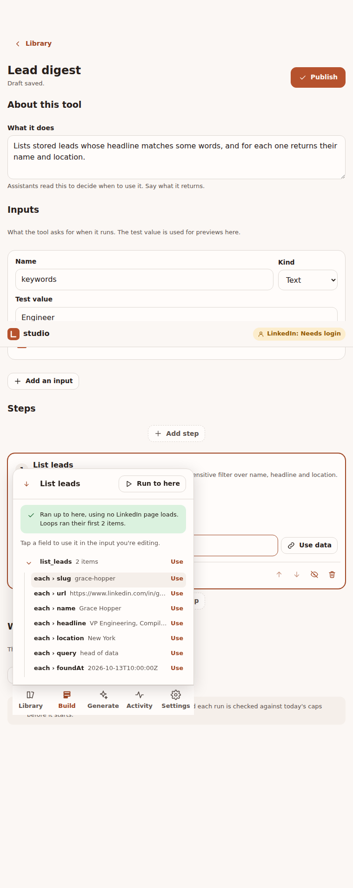
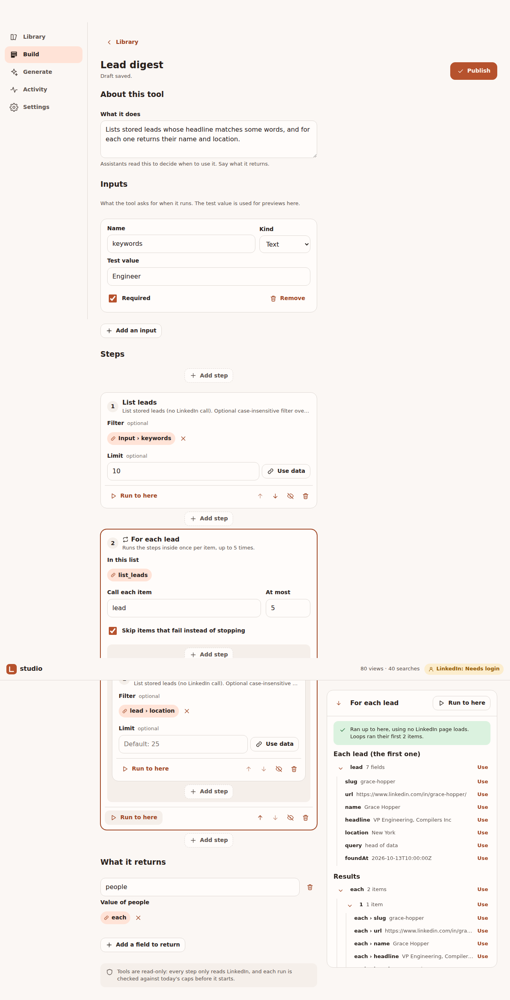

# Journey 3: Compose a tool by chaining APIs

**Status:** built

## Who and when

The owner, after repeating the same sequence a few times ("search for people, then read each profile")
and wanting it as one tool an assistant can call. Done in the studio when they want to see and shape the
data, or from an MCP client when an assistant is already doing the work.

## Example used below

**find_and_read**: input `keywords`; search people, then for each of the first 5 results read the
profile; output a list of profiles.

## Steps in the studio

1. **Start.** "New tool" from the Library. Give it a name (lowercase words joined by underscores) and a
   one-line description; the description is what assistants read to decide when to use it.
2. **Inputs.** Add the inputs the tool takes (`keywords`, text, required). Each input gets a test value
   used for previews.
3. **Add a step.** Pick an operation from the list (search by name or description). The step shows its
   inputs as fields. Fill `keywords` by tapping the `keywords` input chip, or type a literal value.
4. **Preview the step.** "Run to here" runs the step for real with the test values and shows its output
   below it. Before running, the step shows what it will spend ("1 search").
5. **Add a loop.** "For each" on a list in the output (`sample`), with a limit (5). Inside the loop, add
   `view_profile` and tap `url` on the current item to fill its `url` input.
6. **Preview the loop.** Runs the first 2 items by default, so a preview costs little; "Run all"
   runs up to the limit.
7. **Output.** Choose what the tool returns: tap the loop's results, or write an expression.
8. **Save draft / Publish.** Saving checks every reference and shows the worst-case cost of one run
   ("up to 1 search + 5 profile views"). Publishing makes it an MCP tool immediately.

Steps can be moved up and down, disabled for a preview, or removed. The advanced view shows the same
tool as JSON.

## Steps from an MCP client

1. Ask the assistant to make the tool. It calls `define_tool` with the definition.
2. The tool is saved as a draft and checked. If anything is wrong, the assistant gets the errors and fixes them.
3. The assistant (or you, in the studio) publishes it. Clients that keep a fixed tool list reach it
   through `run_operation` until they refresh.

## States

| State | What you see |
|---|---|
| Empty tool | "Add a first step" with the three most-used operations as shortcuts. |
| Reference to a missing field | The chip turns into an error: "`sample` is not in this step's output." |
| Step failed in preview | The step shows the error and the input it received; later steps are not run. |
| Loop item failed | With "skip failures" on, the item is marked and the loop continues; off, the loop stops. |
| Over the daily cap | Preview and publish are allowed; running says "Would exceed today's cap for profile views (12 left)." |
| LinkedIn session expired | "Log in to LinkedIn to preview this step." with a link to journey 1. |
| Unsaved changes, leaving | Changes stay as a draft automatically; nothing is lost. |
| Name already used | "A tool or API with this name exists." |

## Success check

- The published tool appears in the Library and in an MCP client's tool list (after refresh).
- Calling it from the client returns the same output as the studio preview.

## Later (not in the first version)

Conditions (if / else) and parallel branches. The saved format already leaves room for them, so tools
made now will keep working when they arrive.

## Screenshots

