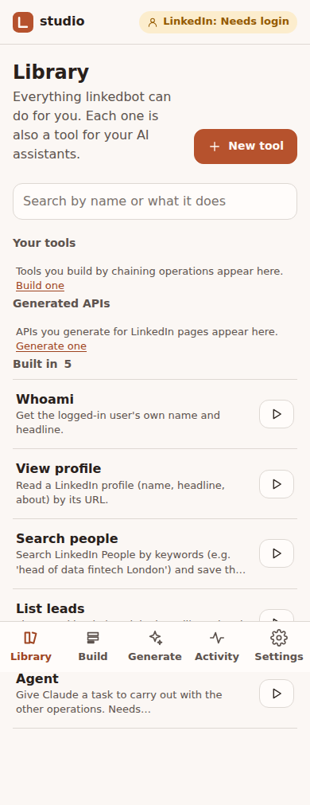
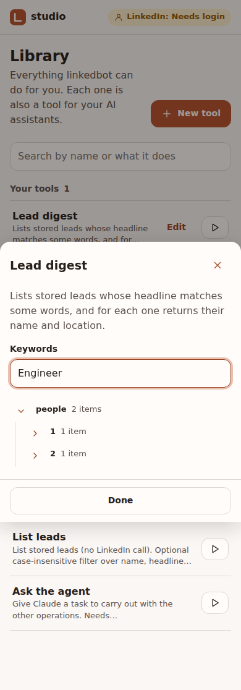
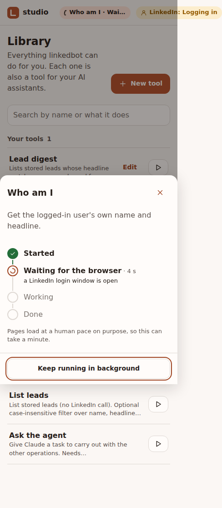
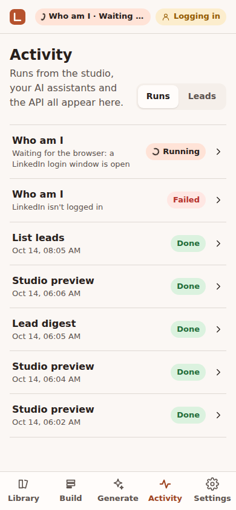
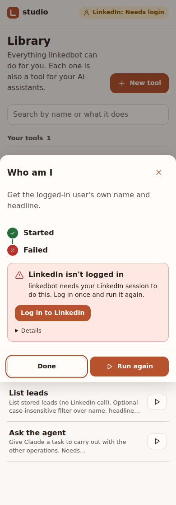
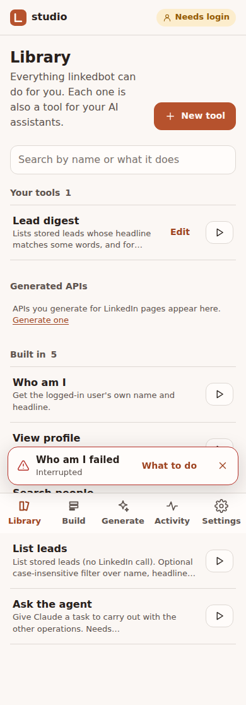
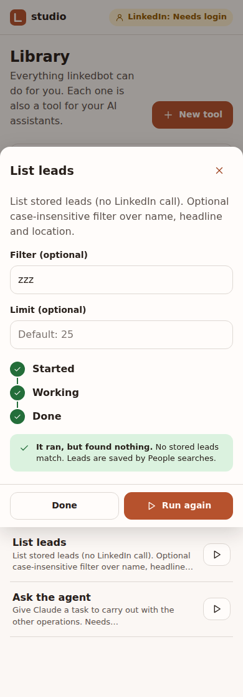

# Journey 5: Run things and read results

**Status:** built (progress and status redesign shipped 2026-10-14)

## Who and when

The owner checking what ran, re-running something, or reading the leads collected so far. Also every MCP
client, whenever it calls a tool.

## Entry points

- Studio: **Library** (everything that can be run) and **Activity** (everything that ran).
- MCP: calling any tool; `get_job` for long calls.
- HTTP API: `POST /jobs`, `GET /jobs/{id}`, `GET /leads` (unchanged).

## Steps in the studio

1. **Library** lists built-ins, APIs and tools with their description, status (draft, published) and
   cost per run. Filter by kind; search by name.
2. **Run** opens the operation's inputs as a form, shows what one run will spend and how much of today's
   caps is left, then queues it.
3. **Activity** lists recent runs, newest first: running, queued (with what it is waiting for), done,
   failed. A run opens to its result and, for tools, each step's output.
4. **Leads** shows the collected leads as a table with CSV export.

## Seeing a run happen (redesign, 2026-10-14)

Runs are always background jobs: starting one never blocks the screen, and closing the sheet or
leaving the page does not stop it. What changed is that a run is now visible from the moment it
starts until you have seen how it ended.

1. **Start.** "Run" switches the sheet to a live run card at once. It shows the run's stages as a short
   vertical timeline: *Queued*, *Waiting for the browser* (with the reason, e.g. "a LinkedIn login is
   open"), *Working* (with what it is doing now, e.g. "Opening your profile", "Reading results page 2
   of 3", "Step 2 of 4: View profile, 3 of 5"), then *Done* or *Failed*. An elapsed timer runs beside
   the current stage. A note says pages load at a human pace on purpose.
2. **Keep going.** "Keep running in background" closes the sheet. The run continues.
3. **Running indicator.** While anything is queued or running, the top bar shows a pill with a small
   spinner, the run's name and its current stage ("Who am I · Opening your profile"; "2 running" when
   several). Tapping it opens Activity.
4. **When it ends.** If you are not looking at the run, a toast slides up above the tab bar:
   - done: "Who am I finished" with **View result**; it fades after 6 seconds;
   - failed: "Search people failed: Today's cap for searches is used" with **What to do**; it stays
     until dismissed, because errors must not be missed.
5. **Results.** Opening a finished run shows the result, or an explicit empty state ("It ran, but found
   nothing: no stored leads match.") instead of a blank area.
6. **Errors explain themselves.** A failed run shows a card with a plain title, what happened, and the
   one action that fixes it: "Log in to LinkedIn" (no session, or paused), "Caps reset at midnight UTC"
   (cap reached), "Check the input" (invalid input), "Try again" (interrupted by a restart). The raw
   message is available under "Details".
7. **Activity** shows the same live stage line under each running item, and the error title under each
   failed one, so the list alone says what is going on.

Why this design: a run takes seconds to minutes and depends on things the owner can't see (a queue,
one shared browser, LinkedIn's pace, daily caps). The timeline names the invisible wait; the pill keeps
it in view anywhere in the studio; toasts close the loop; errors always carry their remedy.

## Long calls from MCP

1. A call that finishes within about 45 seconds returns its result directly.
2. A longer one returns "still running" with a job id. The assistant calls `get_job` with that id; it
   waits up to 45 seconds for the result before answering.
3. Calling the same tool with the same input while it is still running returns the same job instead of
   starting a second one.

## States

| State | What you see |
|---|---|
| Nothing has run yet | Activity explains that runs from the studio, MCP clients and the API all appear here. |
| Queued | "Queued" with what it is waiting for (another run, a LinkedIn login, a generation in progress). |
| Working | The current activity in plain words, with elapsed time; the top-bar pill shows it anywhere. |
| Finished with nothing | "It ran, but found nothing" with what that means for this operation. |
| Failed | An error card: plain title, what happened, the one action that fixes it, raw details folded away. |
| Paused | "Paused: LinkedIn logged this session out." with a link to journey 1. Queued runs continue after login. |
| Daily cap reached | The run fails before loading any page: "Today's cap for searches is used (40)." Caps reset at midnight UTC. |
| Server restarted mid-run | The run is marked failed with "Interrupted by a restart"; queued runs continue. |
| Result too large for the screen | Tables page; the full result is available as JSON. |

## Success check

A run started from an MCP client appears in Activity with the same result the client received.

## Screenshots

